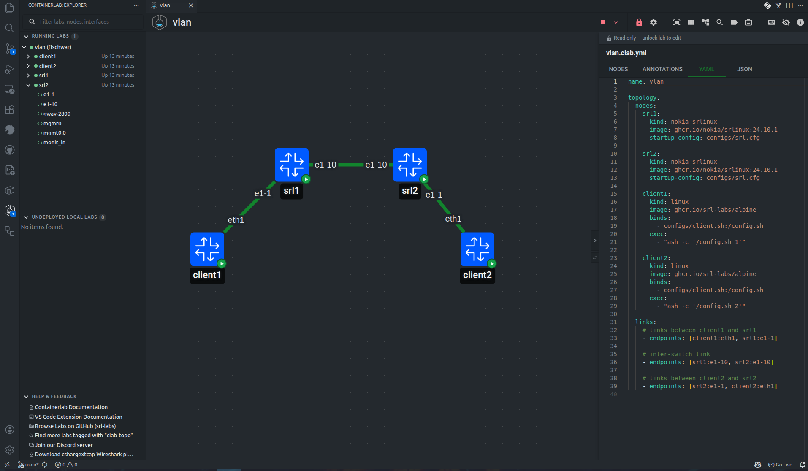
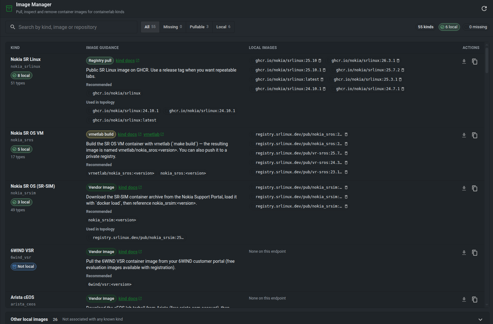

# Run your labs

Deploy a topology, work with its devices, and manage the images your lab needs. These actions run on the Linux host connected to your app.

## Operating labs

From the GUI you can deploy, redeploy, destroy, start, stop, restart, save, graph, and inspect labs where the host supports those actions.

Running nodes expose actions such as:

* open shell
* open SSH session
* show logs
* copy node details
* start, stop, or restart the node
* capture packets from an interface
* manage link impairments

In VS Code, shell and SSH actions open VS Code terminals. In Desktop and Web, terminal sessions are proxied through `clab-api-server` and shown in standalone terminal windows.

### Run with options

The arrow next to the topology viewer's play button opens the lifecycle menu. **Run with options…** at the bottom of that menu deploys, redeploys, or destroys the lab with extra containerlab flags:

| Option | Deploy | Redeploy | Destroy | containerlab flag |
| ------ | :----: | :------: | :-----: | ----------------- |
| Clean up | ✓ | ✓ | ✓ | `-c` |
| Nodes | ✓ | | ✓ | `--node-filter` |
| Graceful shutdown | | ✓ | ✓ | `--graceful` |
| Keep management network | | ✓ | ✓ | `--keep-mgmt-net` |
| Skip post-deploy actions | ✓ | ✓ | | `--skip-post-deploy` |
| Skip lab directory ACLs | ✓ | ✓ | | `--skip-labdir-acl` |
| Max workers | ✓ | ✓ | | `--max-workers` |
| Export template | ✓ | ✓ | | `--export-template` |

The dialog shows the matching `containerlab` command as you change options. Deploy is offered when the lab is not running; redeploy and destroy when it is. Destroying only some nodes leaves the rest of the lab running, so it cannot be combined with clean up.

In VS Code the flags are added for that run, after any `deploy.extraArgs` or `destroy.extraArgs` from the settings. In Desktop and Web they are passed to `clab-api-server`, which does not accept an absolute path for the export template.

## Image manager

The GUI can manage local container images when the host exposes image operations.

Use the image manager to see images referenced by labs and custom node templates, pull missing images, and remove images that are no longer needed.
